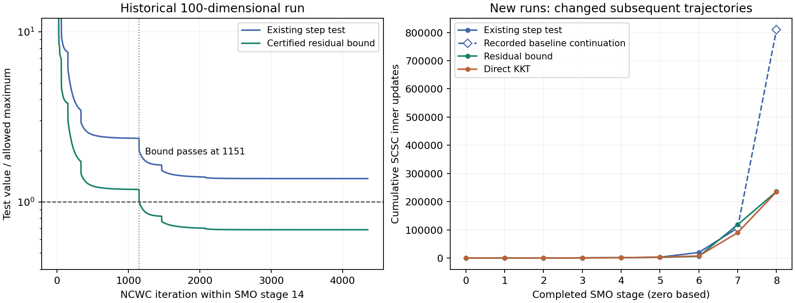

**NCWC stationarity certificate: derivation and experiments, 2026-10-28**

The current NCWC step test is sufficient for the requested stationarity accuracy, but it is not necessary. On the recorded 100-dimensional SMO run, a sharper sufficient test already passes at NCWC iteration 1151 of stage 14; the recorded run continues for another 3202 iterations, or 3.45 hours. New SMO experiments confirm that changing the test can save substantial work while preserving each stage's requested stationarity tolerance. They also show that the benefit is instance dependent and does not eliminate every late-stage bottleneck.

Production solver files were not changed. The experiments instrument an in-memory copy of `optimize_NCWC`, retain the production SCSC solver, and save results in this directory. No W&B runs were created or modified.

**What the existing threshold guarantees**

Let the objective passed into one NCWC call be

$
H(u,v)=h(u,v)+p(u)-q(v),
$

where $u$ contains all minimizing parameters and $v$ all maximizing parameters. For SMO, $u=(x,y)$ and $v=z$; $H$ includes the current SMO penalties and multipliers. It is not merely the plotted upper objective. Write $L=\texttt{lip\_h}$, $D=\texttt{D\_y}$, and let $\epsilon$ be this NCWC call's tolerance, not necessarily the final requested bilevel tolerance.

At NCWC iteration $j$, SCSC solves

$
H_j(u,v)=H(u,v)+L\|u-u_j\|^2-
\frac{\epsilon}{4D}\|v-v_0\|^2
$

to tolerance $\tau_j=\epsilon_0/(j+1)$. The max regularization center $v_0$ is fixed for the NCWC call; the min center $u_j$ moves each iteration.

At a successfully certified SCSC endpoint $(u^+,v^+)$, there are valid subgradients $b_u\in\partial p(u^+)$, $b_v\in\partial q(v^+)$ such that

$
e_u=\nabla_u h+2L(u^+-u_j)+b_u,\qquad
e_v=-\nabla_v h+\sigma_y(v^+-v_0)+b_v,
\quad \sigma_y=\frac{\epsilon}{2D}.
$

SCSC's joint certificate implies $\|e_u\|\le\tau_j$ and $\|e_v\|\le\tau_j$. Removing the NCWC regularizers gives valid residual vectors for $H$:

$
r_u=e_u-2L(u^+-u_j),\qquad
r_v=e_v-\sigma_y(v^+-v_0).
$

Here the minimum achievable residual norms for the original objective are

$
R_u=\inf_{b\in\partial p(u^+)}\|\nabla_u h(u^+,v^+)+b\|,\qquad
R_v=\inf_{b\in\partial q(v^+)}\|-\nabla_v h(u^+,v^+)+b\|.
$

The subgradients supplied by SCSC are admissible in these infima, even though they need not minimize the original residual norms. Thus $R_u\le\|r_u\|$ and $R_v\le\|r_v\|$. With $d_j=\|u^+-u_j\|$, the triangle inequality gives

$
\begin{aligned}
R_u&\le\|e_u-2L(u^+-u_j)\|
\le\|e_u\|+2L\|u^+-u_j\|
\le\tau_j+2Ld_j,\\
R_v&\le\|e_v-\sigma_y(v^+-v_0)\|
\le\|e_v\|+\sigma_y\|v^+-v_0\|
\le\tau_j+\sigma_y\|v^+-v_0\|.
\end{aligned}
$

Both plus signs arise from $\|a-b\|\le\|a\|+\|b\|$, not from changing the signs in the residual vectors. In general, $\|a-b\|\le\|a\|-\|b\|$ is false: if $a$ and $b$ point in opposite directions, subtracting $b$ increases the norm. The maximization block follows exactly the same reasoning. Its residual uses $-\nabla_v h+b_v$ because maximizing $h-q$ is minimizing $q-h$ with respect to $v$. Equivalently, one can use $\nabla_v h-b_v$; negating the whole residual leaves its norm unchanged.

If $D$ bounds the diameter of the maximization domain and both $v^+$ and $v_0$ belong to that domain, then

$
\sigma_y\|v^+-v_0\|\le\frac{\epsilon}{2D}D=\epsilon/2.
$

Consequently, the bounds above imply

$
R_u\le\tau_j+2Ld_j,\qquad
R_v\le\tau_j+\sigma_y\|v^+-v_0\|
\le\tau_j+\epsilon/2.
$

Replacing the actual max displacement by $D$ makes the upper bound more conservative, but makes it independent of the endpoint. It does not enlarge the requested stationarity tolerance. One may retain the actual displacement for a tighter certificate.

The current test in `minimax.py`, $d_j\le\epsilon/(4L)$, allocates $\epsilon/2$ to the min regularizer and another $\epsilon/2$ to inner error, even when actual inner error is orders of magnitude smaller. Specifically, if the SCSC solve is certified and $\tau_j\le\epsilon/2$, then

$
R_u\le\tau_j+2Ld_j\le\epsilon/2+2L\frac{\epsilon}{4L}=\epsilon,\qquad
R_v\le\tau_j+\epsilon/2\le\epsilon.
$

This is a sufficient condition: a small enough step, together with the inner certificate and tolerance condition, guarantees $\epsilon$-stationarity in both blocks. Its converse does not follow. If $d_j>\epsilon/(4L)$, the old test fails, but the residuals may still be at most $\epsilon$. First, a smaller $\tau_j$ leaves more room for $2Ld_j$, so even the bound can pass. Second, an upper bound exceeding $\epsilon$ says nothing conclusive about whether the actual residual exceeds $\epsilon$; vector cancellation and a different choice of subgradients can make the actual residual smaller. Here “stationary” refers to the requested approximate, $\epsilon$-stationarity condition.

For an exact interior example, take $H(u,v)=\tfrac12u^2-\tfrac12v^2$ on $[-1,1]^2$, $L=1$, $D=2$, $\epsilon=0.1$, $u_j=0.12$, and $v_0=0$. An exact SCSC solution is $(u^+,v^+)=(0.08,0)$, since $u^++2(u^+-0.12)=0$. The step is $d_j=0.04>0.025=\epsilon/(4L)$, yet the original residuals are $R_u=0.08<\epsilon$ and $R_v=0$. Thus a step larger than the old threshold can still produce a valid approximate stationary point.

The original NCWC definition uses **separate block norms** bounded by $\epsilon$. A joint norm bounded by $\epsilon$ is stronger. This distinction does not change the production SCSC joint certificate. See Definition 1 and Algorithm 2 of [Lu and Mei's minimax paper](https://arxiv.org/pdf/2301.02060).

**Two alternative tests**

The **bound certificate** tested here accepts after a successful SCSC solve when

$
\tau_j+2Ld_j\le\epsilon
\quad\text{and}\quad
\tau_j+\epsilon/2\le\epsilon.
$

The min step threshold becomes $(\epsilon-\tau_j)/(2L)$, approaching twice the old threshold as $\tau_j$ decreases. This is an accuracy-derived bound, not an arbitrary relaxation. It requires no new gradient evaluation and can apply with generic proximal terms. Valid actual inner residual norms and actual max displacement could tighten it further; those refinements were not used here.

The **direct certificate** evaluates the minimum-norm KKT residuals of $H$ at the same feasible endpoint and accepts when

$
\max(R_u,R_v)\le\epsilon.
$

For a box-constrained minimizing coordinate with gradient $g$, the residual is $g$ in the interior, $\min(g,0)$ at the lower boundary, and $\max(g,0)$ at the upper boundary. For a maximizing coordinate, use $-g$. The experiment requires finite gradients, feasible parameters, exact boundary comparisons, and strict tolerance comparisons without an additive allowance.

The direct test retains all SMO penalty and multiplier terms and removes only NCWC's two quadratic regularizers. It can be stronger than the bound because taking norms loses direction information and because the original objective can use different normal-cone vectors from the regularized subproblem. A large last step can land exactly at a stationary boundary point.

**The recorded SMO stall**

The historical run is `wandb/run-20261023_131037-22bvabs6`, instance `(100,100,5)`, index 1. At its final recorded NCWC iteration 4353 of SMO stage 14:

| Quantity | Value |
| --- | ---: |
| Stage tolerance $\epsilon$ | 0.0439804651110 |
| $L$ | 607.954915139 |
| Inner tolerance $\tau_j$ | 4.65940951e-8 |
| Actual step $d_j$ | 2.47742844e-5 |
| Old step threshold | 1.80854139e-5 |
| Bound-derived step threshold | 3.61707895e-5 |
| Certified bound on $R_u$ | 0.0301233425544 |
| Certified bound on $R_v$ | 0.0219902791496 |

The old test fails while both stationarity bounds pass. Even the joint bound is about 0.037296, below the stage tolerance. Thus the conclusion does not depend on using separate block norms instead of a joint norm.

The bound first passes at iteration **1151**. The following **3202 completed iterations consume 3.4542 recorded hours**. This is a retrospective check along the original stage trajectory, conditional on the successful inner certificates recorded in that run. It is not a claim that a rerun using the new certificate at every earlier stage would save exactly this amount of full-run time. Earlier changes alter the stage-14 input. The same conservative bound did not certify the other three historical runs at their last recorded points; absence of saved iterates prevents a retrospective direct KKT test there.



The left panel is the historical stage-14 trajectory. The right panel compares new SMO trajectories through stage 8; its final dashed baseline segment comes from the recorded original run, as explained below. A [PDF version](comparison.pdf) is available.

**Experiment design and verification**

The harness changes only the NCWC termination expression in an in-memory copy of the existing function. Each candidate is produced by an ordinary, completed SCSC solve at its original tolerance. The experiment refuses to advance after an unsuccessful inner solve. SMO's $\epsilon_s=0.8^s$, $\rho_s=\epsilon_s^{-1}$, $\mu_s=\epsilon_s^{-3}$, warm starts, multiplier updates, and inner accuracy schedule are unchanged.

All real experiments use instance index 1, the generator's seed-0 initialization, float64, one Torch thread, box bounds `[-1,1]`, and explicit analytical gradient callbacks. At every accepted stage endpoint, autograd independently differentiates the scalar stage objective; the audit's box KKT calculation verifies both block norms against the stage tolerance. This residual routine is separate from the production SCSC certificate. All **145 accepted SMO stage endpoints** pass. The largest independently checked block-residual/tolerance ratio is **0.998822731**. All observed endpoints also satisfy the stronger joint criterion; the largest analytical joint ratio is **0.998839912**.

The watchdog budgets were 180 or 240 seconds per run. Interrupted runs are explicitly incomplete. Work counts for incomplete runs include only completed SCSC calls, omitting work inside the interrupted call. All three rules calculate the same diagnostics, so measured seconds include audit overhead; some configurations ran concurrently. Inner-update counts are the main performance comparison, not wall-clock speedup claims.

**New SMO results**

Stages are numbered from zero. The `(100,100,5)` instance is the original historical instance, not a newly sampled problem.

| Instance; requested final tolerance | Rule | Stages completed | Total NCWC iterations | SCSC inner updates | Status |
| --- | --- | ---: | ---: | ---: | --- |
| `(100,100,5)`; 0.3 | Existing | 7 | 92 | 19,786 | Complete |
| Same | Bound | 7 | 35 | 5,998 | Complete |
| Same | Direct | 7 | 36 | 7,336 | Complete |
| `(100,100,5)`; 0.2 | Existing, recorded continuation | 9 | 424 | 809,631 | Historical complete prefix |
| Same | Bound | 9 | 174 | 235,815 | Complete |
| Same | Direct | 9 | 169 | 234,710 | Complete |
| `(4,4,2)`; 0.05 | Existing | 15 | 258 | 159,602 | Complete |
| Same | Bound | 15 | 254 | 159,602 | Complete |
| Same | Direct | 15 | 248 | 158,703 | Complete |
| `(2,3,1)`; 0.01 | Existing | 17 | 735 | 578,263 | Incomplete after 240 s |
| Same | Bound | 18 | 574 | 599,535 | Incomplete after 240 s |
| Same | Direct | 18 | 563 | 587,465 | Incomplete after 240 s |

For the 0.2 baseline, the new replay reached 298 completed NCWC iterations and 417,113 completed inner updates before its 180-second budget. All 298 step norms and per-call inner-update counts match the recorded run **exactly**. The table therefore uses the historical continuation through stage 8 for the completed baseline comparison. This provenance is checked by assertions in `summarize.py`; the fresh baseline did not itself finish stage 8 within its budget.

Through stage 8, the direct certificate uses **71.01% fewer inner updates** than that recorded baseline. Both new variants finish with actual stage tolerance $0.8^8=0.16777216$. Their final stage values are:

| Rule | Upper objective | Constraint-violation norm | Lower-level objective gap | Min KKT residual | Max KKT residual |
| --- | ---: | ---: | ---: | ---: | ---: |
| Existing, recorded | -142.621862 | 0.0333314 | 0.119092 | Not logged directly | Not logged directly |
| Bound | -142.648648 | 0.0364464 | 0.134514 | 0.1667690 | 0.000849733 |
| Direct | -142.583341 | 0.0353049 | 0.128007 | 0.1675746 | 0.000982899 |

These are different valid approximate stage solutions. The new endpoints can have somewhat larger feasibility or lower-gap errors; preserving the stage stationarity tolerance does not preserve the exact output coordinates or objective values. This completed 0.2 run is not evidence that the original much tighter final target would finish quickly.

For `(4,4,2)` through stage 14, the bound saves no inner updates, and direct saves only **0.56%**. Direct's final min residual is 0.0205669 against tolerance 0.0439805, while its last step is **2.85 times** the old threshold and the bound on the min residual is 0.0626711, too large to pass. This illustrates the additional benefit of a direct normal-cone calculation even when total work savings are small.

The smallest instance is a useful negative result. Under both new certificates it reaches stage 18, one stage further than baseline, but remains incomplete. At the last completed inner solve in stage 18, its direct min residual is **0.0496945**, exceeding that stage's tolerance **0.0180144**. The certificate correctly refuses to call this converged. The partial-run work counts cannot be interpreted as speedups to the same endpoint.

Direct is not uniformly cheaper than bound across a full SMO run. Through stage 6 of the large instance it uses 7336 inner updates versus bound's 5998. For a fixed NCWC input, a direct certificate should pass no later than a valid bound certificate along the same sequence. Across SMO stages, however, the earlier returned points change the next multipliers and warm starts; the sequences are no longer the same.

**Analytically interpretable checks**

The three scalar examples use boxes `[-1,1]`, $L=1$, $D=2$, $\epsilon=0.1$, $\tau_0=0.001$, and initial $v=0$.

| Objective $H(u,v)$; initial $u$ | Existing NCWC / inner updates | Bound NCWC / inner updates | Direct NCWC / inner updates |
| --- | ---: | ---: | ---: |
| $0.075u-0.5v^2$; 1 | 54 / 15,073 | 1 / 52 | 1 / 52 |
| $-10u-0.5v^2$; 0 | 2 / 1 | 2 / 1 | 1 / 1 |
| $0.5u^2-0.5v^2$; 1 | 8 / 1,316 | 6 / 1,222 | 6 / 1,222 |

The linear case explains why almost doubling the allowed step can save far more than a factor of two in work. Its interior residual is a constant 0.075, already below 0.1, but its approximately 0.0375 step remains above the old 0.025 threshold. The old test continues until the boundary is reached. Bound/direct return $u\approx0.962819$, objective 0.0722114, while baseline reaches $u=-1$, objective -0.075. The original accuracy contract is satisfied by both: stationarity at a coarse tolerance does not mean a small objective gap.

The boundary case reaches the exact optimum $u=1$ in the first subsolve. Direct immediately recognizes its zero residual; the step-based tests require a second subsolve. The quadratic case gives an interior example without active constraints: direct/bound return residual 0.0879264, while baseline continues to 0.0391221. Both are below 0.1.

**Consequences for the algorithm**

The tested change preserves the requested NCWC output stationarity condition. It does not relax SCSC's accuracy or use an objective plateau as an exit condition. In particular, it waits for a successful SCSC solve before testing the original stage objective. Under the original assumptions, it returns a prefix of the same certified NCWC sequence for a fixed call. The original NCWC paper's Lemma 3 gives its merit bound for every such prefix; the endpoint stationarity can be supplied by the direct test instead of the step bound. See [Lemma 3 and the proof of Theorem 2](https://arxiv.org/pdf/2301.02060).

SMO requests approximate stationarity of its stage saddle objective and then updates multipliers. Keeping that objective, its tolerance, and the certified subsolve sequence is materially different from simply weakening accuracy. The stage contract and update structure appear in [SMO Algorithm 1](https://arxiv.org/pdf/2511.07398). Nevertheless, different accepted endpoints change subsequent multipliers, warm starts, and work. These experiments do not establish a universal improvement to full SMO complexity or identical final bilevel quality.

This experiment also does not justify exiting *inside* SCSC based only on an NCWC residual: that could skip the prescribed inner accuracy and requires a separate argument. Likewise, a budget exhaustion must not be relabeled as convergence. Failed inner-solve propagation in production NCWC is a separate concern; the harness explicitly rejects such a failure, and none occurred before the completed experimental subsolves.

For this linear SMO experiment, $L=2\mu_s L_g^2$ and $\mu_s=\epsilon_s^{-3}$, so both step thresholds shrink proportionally to $\epsilon_s^4$. The direct test avoids this indirect acceptance threshold, but it does not change the large regularization curvature generating the steps, the shrinking SCSC tolerance, or the conditioning of later stages. This explains why fixing unnecessary iterations can coexist with genuine remaining bottlenecks.

A practical implementation would check direct box KKT stationarity after a successful deterministic SCSC return, use the derived bound where direct proximal residuals are unavailable, and retain/log the original sufficient step test. It should log the termination reason, both original-objective residuals, their stage tolerance, and the inner certificate status. The bound requires no extra gradient evaluation; this direct implementation evaluates one original-objective gradient per completed NCWC iteration. That cost is small compared with the hundreds or thousands of SCSC updates in difficult calls.

The formula is shared NCWC logic and can cover FOP and GCMO with their own stage objectives and domains, including GCMO multiplier boxes. The new performance experiments here are SMO only. No full tighter-tolerance SMO completion, new FOP/GCMO speedup, or resolution of all four ten-hour runs is claimed.

**Artifacts and reproduction**

- [experiment.py](experiment.py): bounded instrumented runs, strict certificates, independent autograd endpoint checks.
- [analytic.json](analytic.json): the nine scalar-case results.
- `smo-*.json`: complete per-NCWC-iteration diagnostics and per-stage metrics for all twelve configurations, including incomplete runs.
- [summary.json](summary.json): experiment summaries, historical bound, and verified baseline continuation provenance.
- [summarize.py](summarize.py): regenerate the summary and comparison figure from local results and the original W&B history.

From the repository root, for example:

```bash
OMP_NUM_THREADS=1 MKL_NUM_THREADS=1 OPENBLAS_NUM_THREADS=1 \
  /data/scratch/yshen48/conda-envs/minimax/bin/python \
  reports/ncwc_certificate/experiment.py --kind smo --size 100 100 5 \
  --index 1 --epsilon .2 --rule direct --seconds 180
```

Repeat with `--rule baseline` and `--rule bound`; other configurations are `(100,100,5), .3, 240 seconds`, `(4,4,2), .05, 180 seconds`, and `(2,3,1), .01, 240 seconds`. Scalar cases use `--kind analytic --case linear|boundary|quadratic` with each rule; the CLI saves individual scalar JSON files, while `analytic.json` contains the aggregate from this investigation. Re-running a configuration overwrites its corresponding JSON artifact. Time-budget-dependent partial counts can vary.

```bash
/data/scratch/yshen48/conda-envs/minimax/bin/python reports/ncwc_certificate/summarize.py
python reports/ncwc_certificate/summarize.py --plot
```

The first command needs the existing local W&B run and its Python environment. The second uses system Python's Matplotlib; the Torch environment does not contain Matplotlib.
