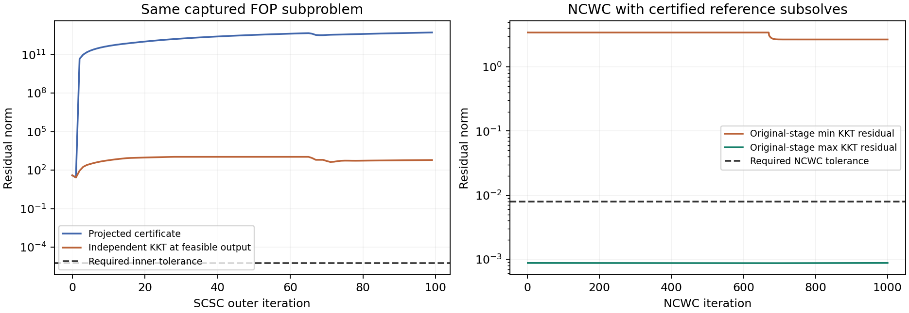

**Why the larger budgets still do not resolve small FOP runs — 2026-11-04**

The larger FOP limits expose two separate performance problems: the SCSC iteration has very unfavorable curvature scaling and large extrapolation transients, and NCWC takes very small steps even when its regularized subproblems are solved accurately. The problem dimension `(5,5,2)` makes each gradient cheap; it does not ensure a small iteration count.

This investigation changes no production solver code or experiment settings. Diagnostics call the solver wrappers directly with explicit settings, create no W&B runs, and preserve the user's ongoing runs.

**What the recorded runs actually show**

- FOP `run-20261104_150801-7jn3nd4d`, `BASE_RHO=5`, fails at stage 4, the fifth stage. Its first SCSC subproblem exhausts 5000 outer iterations and 1,388,140 inner updates. The displayed projected certificate is 91,838,893,772.67749 against tolerance 5.7243340224e-6. Increasing the SCSC limit from 1000 to 5000 did not certify this solve.
- SMO `run-20261104_150735-klszqcjt`, with NCWC limit 1000, has advanced beyond the previous budget failures. It completes stage 14 in 20 NCWC iterations, stage 15 in 142, stage 16 in 72, stage 17 in 80, stage 18 in 92, and stage 19 in 109. The earlier limits of 10 and 100 prevented that progress. The snapshot in `live_status.json` records the latest inspected status; absence of a finished result must not be described as a confirmed failure or successful completion.
- FOP `run-20261104_151841-tdx3oywy`, with `BASE_RHO=2`, also progresses into later stages. At the inspected snapshot it is still solving stage 6. The smaller penalty multiplier has not established full completion at final tolerance 0.01.

**An exact replay of the problematic FOP input**

The offline replay reconstructs the base-5 FOP run from the same seed and initialization. All **101 completed NCWC subsolves preceding stage 4 match the recorded run exactly** in step size, minimizing residual, and inner-update count. The next SCSC input is saved in `fop_stage4.pt`, including its parameter values, regularization anchors, oracle data, and coefficients.

At this input:

| Quantity | Value |
| --- | ---: |
| rho | 125 |
| mu | 15625 |
| rho times mu | 1,953,125 |
| NCWC tolerance | 0.008 |
| L / declared sigma_x | 7669.206083 |
| Declared sigma_y | 0.000894427191 |
| Declared full smoothness | 23007.619143 |
| Smoothness / minimum declared curvature | 25,723,300 |
| SCSC alpha | 0.000965923 |
| Projected-certificate step | 1.68966899e-12 |
| Required SCSC residual | 5.72433402e-6 |

The regularized objective remains strongly convex–strongly concave. For example, a global lower bound on its minimizing curvature is `2*L - 2*rho*mu*||A||^2 = 14061.23077`, above the declared sigma_x. The weak maximizing curvature can equal sigma_y along directions in the null space of B. Thus favorable strong-convexity constants cannot be inferred from the small dimension.

Running production SCSC for 1000 outer iterations on this captured input reproduces the earlier recorded failure **exactly**: 272,140 inner updates, with final certificate `0.0017406530030039968`. Independent autograd gives a joint box KKT residual of `0.0017406530030023308` at the returned feasible point. This particular failed endpoint really is insufficiently stationary; it is not a false rejection caused solely by the certificate formulation.

**The requested precision is attainable**

For diagnostic purposes, the same frozen problem can be reduced to four dual weights. Writing c=rho*mu, the squared positive-part penalties introduce weights alpha=2c[Ax+By-b]+ and beta=2c[Ax+Bz-b]+. Given these weights, the minimizing x/y and maximizing z coordinates are exact clipped affine formulas. Solving the resulting four equations produces a reference saddle point.

This reference uses the special structure of this small linear problem and derivative information beyond the production first-order solver. It is an independent accuracy reference, not a fair first-order benchmark or a proposed silent replacement for the paper's solver.

On the captured production input, the reference solve takes about **0.08 seconds**. Differentiating the original scalar regularized objective independently with autograd yields:

| Residual | Norm |
| --- | ---: |
| Minimizing block | 1.01456499e-11 |
| Maximizing block | 1.46472352e-11 |
| Joint | **1.78178481e-11** |

The joint residual is below the unchanged target 5.72433402e-6. Restarting production SCSC at that reference point immediately returns `inner_certificate`, with joint residual about 1.80e-11 and zero inner updates. This rules out an unattainable tolerance for this frozen problem and verifies that the certificate can recognize a sufficiently accurate solution.

**The huge printed delta is not the feasible-point KKT norm**

The displayed outer certificate in SCSC corresponds to Algorithm 5's projected residual construction, which uses an extrapolated point and a projection quotient. The true minimum-norm KKT residual at the projected, feasible point can be much smaller. The implementation follows the displayed update formulas in [Algorithm 5](https://arxiv.org/pdf/2301.01716v2#page=25); this inspection did not identify a verified transcription error.

A second controlled replay checks both residuals independently after each of the first 100 SCSC outer iterations. At iteration 99:

- projected certificate: **5.3165e12**;
- independent feasible-output KKT residual: **619.765**;
- distance of the extrapolated point from the box: **8.98316**.

The tiny certificate step amplifies this extrapolation distance. The feasible candidate still fails the requested tolerance, but interpreting the projected value as a trillion-scale true KKT error would be incorrect. These observations establish large extrapolation transients and certificate inflation; they do not alone prove an unstable recurrence or an implementation bug. They also do not justify reporting convergence.

**Accurate inner solves alone do not make the proposed outer budget sufficient**

At the first reference saddle point, the regularized SCSC KKT norm is approximately 1.78e-11, but the original NCWC-stage minimizing residual is **3.44619**, against stage target **0.008**. These are stationarity checks of different objectives.

To isolate outer progress, a separate experiment continues the captured NCWC call for 1000 iterations using the reference subsolver. It keeps the original stage objective, L, fixed maximization regularization center, and scheduled inner tolerances `tau0/j`. Every one of the **1000 subsolves** passes an independently differentiated joint KKT check at its scheduled tolerance. There is no tolerance allowance or successful relabeling of a budget exit.

After those 1000 certified subsolves:

| Quantity | Value |
| --- | ---: |
| Original-stage min KKT residual | **2.68148134** |
| Original-stage max KKT residual | 0.000874889 |
| Required blockwise tolerance | **0.008** |
| Outcome | NCWC iteration limit; incomplete |

This is a reference continuation of the same captured call, not an exact replay of production's future trajectory: different acceptable inner outputs can alter that trajectory. Nevertheless, it demonstrates that eliminating the inner-solver accuracy problem does not automatically make 1000 NCWC iterations sufficient for this stage.

The reason is visible in the proximal stationarity equation. With an accurate inner solve, the original minimizing residual is balanced by approximately `2*L*(u_j-u_{j+1})`. Here the implied step scale is `1/(2*L) = 6.52e-5`. A residual around 3.44 therefore produces a displacement around 0.0002247 per iteration. On a fixed face of a box-constrained piecewise quadratic problem, many such displacements can occur before a variable reaches a boundary and the residual drops. The reference trace shows long nearly constant residual sections.



A [PDF version](comparison.pdf) is also provided.

**What the evidence supports**

The previous budget recommendations were diagnostic starting points. These measurements show that their FOP limits are inadequate at this penalty stage. Further cap increases extend the same update process; they do not improve its rate. A numerical or algorithmic improvement should be checked against the saved hard input and the independent reference, then validated through the full continuation. No further increase is asserted to resolve final tolerance 0.01.

The concrete remaining work is to address both SCSC's transient behavior and NCWC's conservative regularization-driven movement. Tighter valid curvature bounds, preconditioning, different certified inner strategies, and preserving better stage initializations are candidates for controlled tests. A new stopping allowance would not address the genuine residual remaining in the 1000-step reference continuation.

The new SMO run should be judged separately: its larger NCWC budget has already removed its earlier cap failures and completed additional stages. Its full-run success remains unverified until its final certificates and instance checks pass.

**Artifacts and reproduction**

- `diagnose.py`: exact prefix capture, production SCSC replay, independent reference solve, feasible-point KKT checks, and a restart at the reference point.
- `fop_stage4.pt`: captured input; reused automatically to avoid replaying the expensive prefix.
- `results.json`: exact 1000-outer-iteration production failure and reference result.
- `trace100.json`: 100-iteration comparison between the projected certificate and independent feasible-output KKT norms, plus the reference restart.
- `reference_ncwc.py` and `reference_ncwc.json`: 1000-step continuation with separately certified reference subsolves.
- `live_status.json`: local W&B status snapshots for the ongoing SMO and base-2 FOP runs.

From the repository root:

```bash
OMP_NUM_THREADS=1 MKL_NUM_THREADS=1 OPENBLAS_NUM_THREADS=1 \
  /data/scratch/yshen48/conda-envs/minimax/bin/python reports/scsc_conditioning/diagnose.py

OMP_NUM_THREADS=1 MKL_NUM_THREADS=1 OPENBLAS_NUM_THREADS=1 \
  /data/scratch/yshen48/conda-envs/minimax/bin/python \
  reports/scsc_conditioning/diagnose.py --probe-outers 100 --output trace100.json

OMP_NUM_THREADS=1 MKL_NUM_THREADS=1 OPENBLAS_NUM_THREADS=1 \
  /data/scratch/yshen48/conda-envs/minimax/bin/python reports/scsc_conditioning/reference_ncwc.py

python reports/scsc_conditioning/plot.py
```

The capture phase has a 650-second watchdog, individual production probes a 180-second watchdog, and reference continuation a 120-second watchdog. The source version used for the first `results.json` predates the added per-outer trace; subsequent reproductions also record that trace. Numerical accuracy comparisons use the same captured objective; wall times include different overhead and should be treated as diagnostic measurements.
